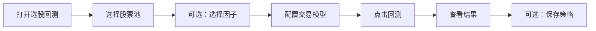

入口是产品页的 **选股回测**。

| 步骤 | 你要做的 | 页面上看到 |
|------|----------|------------|
| 1 | 打开选股回测 | 股票池、交易模型的默认项、最近的回测 |
| 2 | 选择股票池 | 可以预览池里的股票 |
| 3 | 需要时，在左侧点选因子，并选择交集或并集 | 预览当天入选的股票。这一步还不是回测 |
| 4 | 在右侧配置交易模型 | 区间、对比指数、买卖规则、仓位和过滤 |
| 5 | 点击「回测」 | 算完后进入结果页：绩效、收益曲线、成交明细 |
| 6 | 需要留下这次配置时，保存策略 | 会按回看区间回测到今天。每个交易日行情更新后会重跑，刷新收益和持仓 |
| 7 | 以后再打开某次结果 | 可以看到当时的绩效和收益曲线，成交明细可以翻页 |

## 成交怎么发生

- 买卖信号在前一个交易日收盘确认，下一个交易日开盘成交。
- 默认买入当天不能卖，下一个交易日起可以卖。
- 停牌不成交。开盘涨停不能买，开盘跌停不能卖。
- 买卖都扣佣金和滑点，卖出再扣印花税。
- ST 默认可以买。勾选「排除 ST/*ST」后，戴帽区间内不买。
- 结果页可以翻看成交。成交只留在当次打开的结果里。

买卖规则和结果里每个数的算法，见 [指标、买卖点与回测结果](/backtest/signals)。
