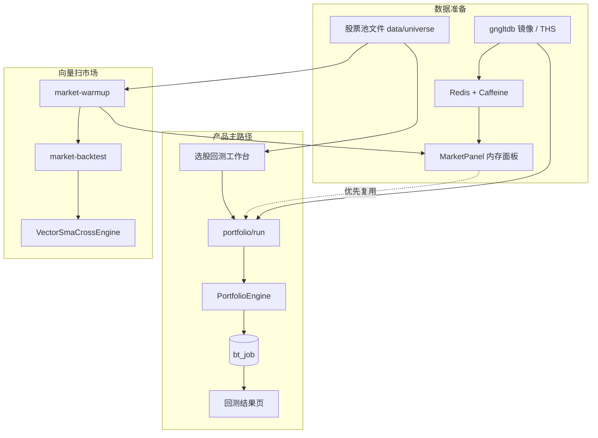

{/* 同步自 java-quant-backtest/docs/BACKTEST_FLOW.md */}

更新日期：2026-10-14

本文从**产品使用路径**与**工程实现路径**说明当前系统里两条回测线如何串起来。

---

## 一、总览：两条回测线

| 线 | 产品入口 | 核心 API | 引擎 | 是否落 `bt_job` | 典型用途 |
|----|----------|----------|------|-----------------|----------|
| **A. 组合选股回测** | `/product/` → 选股回测 | `POST /api/v1/portfolio/run` | `PortfolioEngine` | **是** | 工作台主流程：股票池 + 右侧交易模型 |
| **B. 全市场向量扫一遍** | 运维/研发（暂无产品页） | `market-warmup` → `market-backtest` | `VectorSmaCrossEngine` | **否** | 全 A 毫秒级排名/压测 |

> 单票 ta4j 回测路径已移除；客户端与产品页统一走组合回测。
>
> **成交口径**：信号在昨收确认 → 次日开盘成交；有 `bt_trade_calendar` 时与基准取交集推进；默认 T+1、涨跌停/停牌、印花税。ST 默认可交易，勾选「排除 ST/*ST」才整段不买。涨跌停优先用同花顺当日 `ul_price` / `dl_price`；没有公布价时按板块生效日和该股 `st_hat` 区间取板幅（主板 10%、主板 ST 区间 5%、创业板 2020-08-24 起 20%、科创板 20%、北交所 30%）。可选动量前 N%、流通市值下限、同申万一级行业持仓上限。全量组合自动预热并复用 `MarketPanel`。成交明细只留在跑任务的那台进程内存里。



---

## 二、产品视角

### 2.1 前置条件

1. 服务已启动（`mirror` 模式读 `gngltdb` 推荐）。
2. 近 3 年全 A 日 K 已同步到镜像（见 [`market-mirror.md`](/data/mirror)）。
3. 股票池文件就绪：`data/universe/all_a_codes.txt` 及可选 `factors/*.txt`。
4. （建议）全 A 已预热进内存 Panel。
5. 演示用户头：`X-User-Id: demo_user`。

### 2.2 主流程：选股回测（组合）

入口：`http://127.0.0.1:8080/product/` → **选股回测**。

| 步骤 | 用户动作 | 系统行为 |
|------|----------|----------|
| 1 | 打开页面 | 拉股票池列表、`portfolio/meta`、最近任务 |
| 2 | 选 Universe | 预览代码；可设调试样本上限 |
| 3 | 配右侧交易模型 | 区间、对比指数、买卖择时、仓位 |
| 4 | 点「回测」 | 一律同步 `POST /portfolio/run`，请求返回后才出结果 |
| 5 | 看结果 | 指标、净值曲线、成交（`/jobs/{id}/trades`，内存分页） |
| 6 | （可选）保存策略 | `POST /portfolio/strategies`。立刻回测到今天；每个交易日 17:00 行情同步后重跑，更新收益和持仓 |
| 7 | 重开结果 | 结果页带 `jobId` → `GET /portfolio/jobs/{id}` |

### 2.3 研发流程：全市场向量扫

1. `POST /universe/market-warmup`
2. `POST /universe/market-backtest` → `computeMs` / top-bottom  
不写入回测记录。

### 2.4 选股因子与回测的边界

| 模块 | 是否走回测引擎 | 说明 |
|------|----------------|------|
| 选股回测工作台 | **是**（组合） | 即时计算 |
| 左侧因子列表 / 今日预览 | **否** | 读 `gn_factor` / 最新一个信号日 |

---

## 三、开发视角

### 3.1 数据平面

```text
股票池文件 ──UniverseFileService──► 代码列表
行情源 ──ThsMarketDataRepository──► MySQL（mirror / ths）
         ThsBarLoader.loadCompact → CompactSeries
         MarketBarCache（Caffeine + Redis）
         MarketPanelService.warmup → MarketPanel
```

### 3.2 组合回测

```text
product.js 工作台 → 点击回测 → #/backtest/result 结果页
  → PortfolioApiController.run
  → PortfolioBacktestService
       ├─ resolveCodes（优先 factorCombo → candidateCodes → universe 文件）
       ├─ loadStocksPreferPanel
       ├─ PortfolioEngine.run（内存撮合）
       ├─ reportCache（净值、成交、期末持仓）
       └─ BacktestJobRepository.insertFinished（只要摘要，不写成交）
  → 结果页展示指标/净值/成交；GET /portfolio/jobs/{jobId} 供记录复看
```

### 3.2.1 因子词典组合选股

选股回测左栏「因子词典」：从 `gn_factor` 点选最多 10 个高能因子，选交集 AND / 并集 OR，
每因子默认「命中当日 `gn_factor_signal`」；有数值列时可设 LT/GT/BETWEEN/PERCENTILE。
预览：`POST /api/v1/product/factor-combo/preview`；保存：`…/save` → `gn_factor_combo`。
回测请求体带 `factorCombo`，`resolveCodes` 与底池（默认 `all_a`）求交后得到候选池。
板块/行业成分：启动或 `POST /api/v1/product/factor-combo/refresh-sectors` 从
`lm_ths_db.stk_corp_ic`（+ `ls_sec_basic_info`）写入 `gn_factor_signal`。
概念专题指数成分尚未对齐 `ths_index_his_stocks` 的 index_id，暂以行业板块为主。

### 3.3 向量全市场

```text
market-warmup → MarketPanel
market-backtest → VectorSmaCrossEngine
```

---

## 四、推荐自测

```bash
curl -s -X POST http://127.0.0.1:8080/api/v1/universe/market-warmup \
  -H "Content-Type: application/json" \
  -d "{\"universeId\":\"all_a\",\"lookbackYears\":3,\"limit\":50}"

curl -s -X POST http://127.0.0.1:8080/api/v1/portfolio/run \
  -H "Content-Type: application/json" -H "X-User-Id: demo_user" \
  -d "{\"universeId\":\"all_a\",\"lookbackYears\":3,\"benchmarkCode\":\"000300\",\"warmupLimit\":50}"
```

ApiPost：`docs/api/apipost.collection.json`（`api/apipost.collection.json`）。

---

## 五、相关文档

| 文档 | 内容 |
|------|------|
| [`TECH_DESIGN.md`](/guide/tech-design) | **技术实现方案（评审主文档）** |
| [`DEPLOY.md`](/guide/deploy) | 部署资源 |
| [`market-mirror.md`](/data/mirror) | 镜像同步 |
| [`universe-bench.md`](/backtest/universe-bench) | 全市场耗时 |
| [`api/README.md`](/api/overview) | API / ApiPost |
