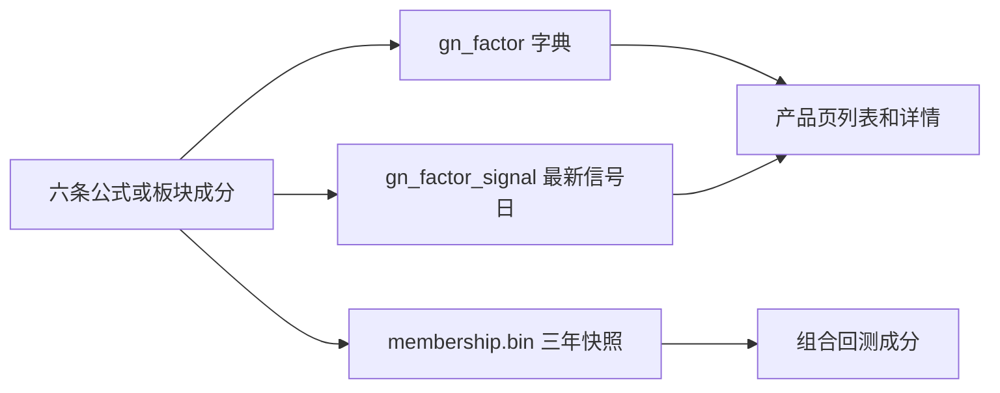

1. **定义。** 公式是六条固定条件，或由 `stk_corp_ic` 刷新成板块因子。
2. **登记。** `gn_factor` 记下名称、分类、文案、`source_type` 和 `status`。
3. **预计算。** 历史成分进入 `membership.bin`。最新一个信号日写入 `gn_factor_signal`，给页面预览。
4. **展示。** `ONLINE` 的记录出现在推荐、独家或板块。用户可关注，关注存在 `gn_user_follow`。
5. **引用。** 用户把最多 10 个 `factor_id` 收成组合，存 `gn_factor_combo`。
6. **使用。** 回测按区间向 8081 要每日成分，再做组合撮合。买卖点不在这一步计算。
7. **下架。** `OFFLINE` 后列表不再返回。关注记录保留。

未知的买入信号会回落到 `SMA_GOLDEN`，未知的卖出信号回落到 `MA_DEATH`。这是交易模型的默认值，不是因子生命周期的一部分。
