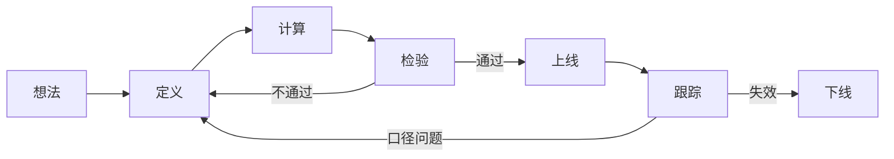

1. **想法。** 来自市场观察、研报、经典指标或已有因子的改进。
2. **定义。** 写清输入、窗口、无效值和输出形态。见 [因子编写](/factor/authoring)。
3. **计算。** 全量回填历史，再接入每日增量。见 [因子预计算](/factor/precompute)。
4. **检验。** 看 IC、分层收益、换手和样本外表现。见 [开发进阶](/factor/advanced)。
5. **上线。** 进入因子列表，可被选股和组合使用。
6. **跟踪。** 持续观察阶段收益和超额。见 [因子跟踪](/factor/tracking)。
7. **下线。** 失效或被更好的因子替代时停止使用。历史回测结果保留，便于复盘。

<Note>
下线只停止新的使用。已经引用过这条因子的历史回测，应保留当时的定义和参数。
</Note>
