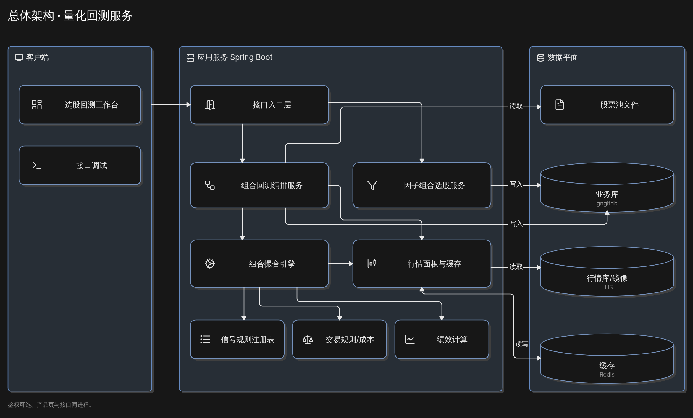
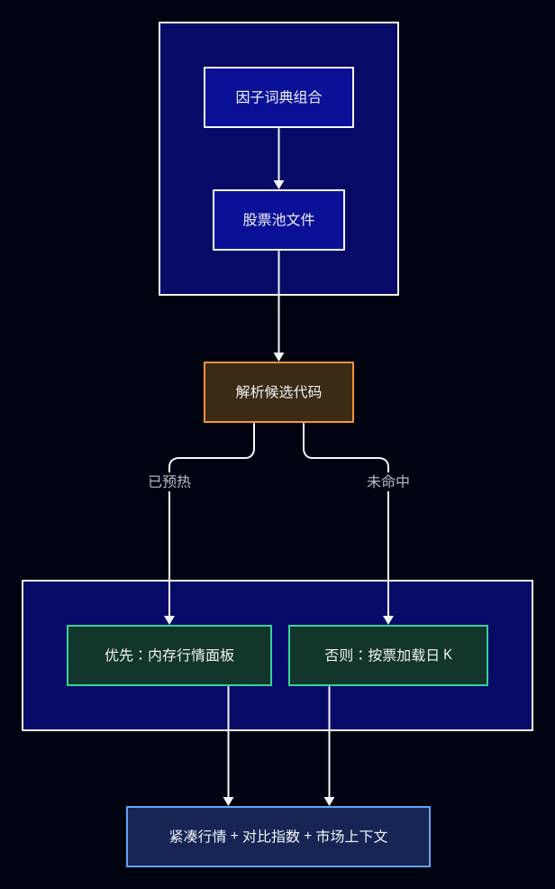
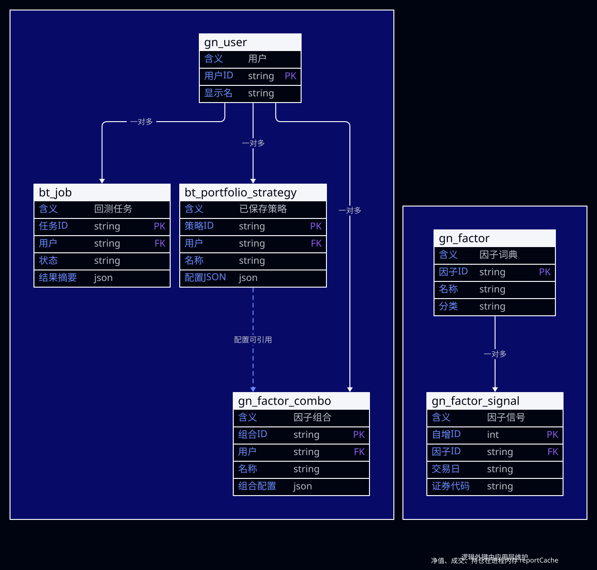
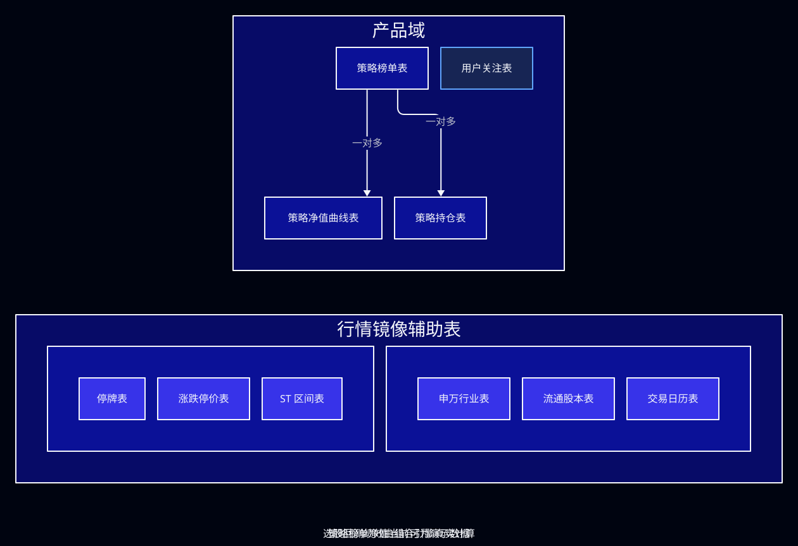
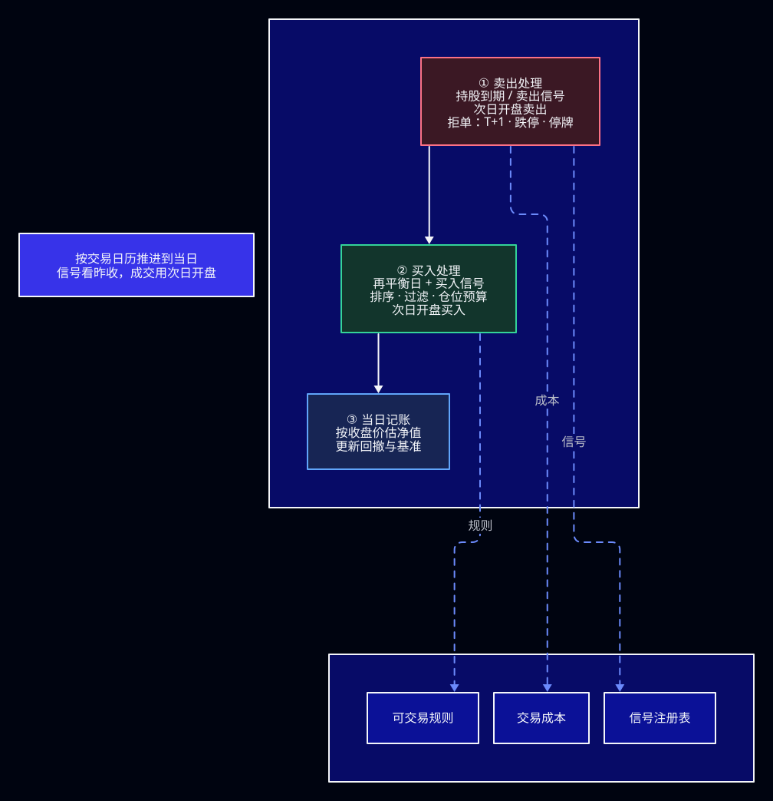
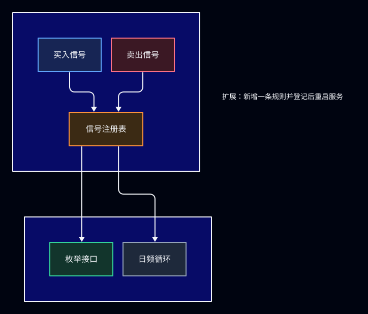

import { BacktestFlow } from "/snippets/portfolio-flow.jsx";

## 1. 目标与范围

### 1.1 目标

提供**可复现的 A 股日频组合回测**能力：

1. 候选池（股票池文件 / 因子词典组合）+ 交易模型配置 → 模拟撮合与绩效；
2. 任务摘要落 `bt_job`。净值、成交、期末持仓只在进程内存，结果页可分页看成交；
3. 行情可走同花顺远端或本地镜像，支撑全 A 级加载与预热。

### 1.2 范围内 / 范围外

| 范围内（当前） | 范围外（暂不做或未做） |
|----------------|------------------------|
| 日频事件驱动组合回测 | Level-2 / 盘口撮合 |
| 昨收信号 → 次日开盘成交 | 分钟线、逐笔回放 |
| 因子词典交并集选股 | 策略榜单、关注和个人中心 |
| 涨跌停/停牌/T+1/成本 | 机构级绩效库（empyrical 等）对接 |
| 买卖信号规则注册表横扩 | 再平衡/仓位模式的插件化注册 |

---

## 2. 总体架构

<Frame>
  
</Frame>

---

## 3. 模块划分

| 模块 | 职责 |
|------|------|
| 组合回测 | API、配置、引擎编排 |
| 买卖信号 | 信号规则与登记 |
| 交易规则 | 成本、涨跌停、停牌、市场上下文 |
| 绩效 | Sharpe、换手近似 |
| 行情面板 / 缓存 | 紧凑行情、全市场预热、缓存 |
| 行情加载 | 日 K 与辅助表 |
| 因子组合 | 交并集预览、保存、板块成分刷新 |
| 股票池 | 股票池文件 |
| 任务存储 | 任务摘要落库 |

---

## 4. 数据平面

### 4.1 库职责

| 角色 | 库 | 用途 |
|------|----|------|
| 行情读 | `lm_ths_db` 或 `gngltdb` 镜像（`quant.ths.mode`） | 日 K、复权、证券、涨跌停/ST/停牌/股本/日历/行业 |
| 业务写 | `gngltdb` | `bt_job` 摘要、`bt_portfolio_strategy`、`gn_*`。成交不写库 |
| 缓存 | Redis + Caffeine | 日 K 序列缓存；Panel 内存面板 |

### 4.2 加载路径

<Frame caption="候选池解析与行情加载路径">
  
</Frame>

镜像同步与表说明见 [行情镜像（THS → gngltdb）](/data/mirror)、[同花顺库表结构：lm_ths_db](/data/ths/index)、[测试库 gngltdb](/data/gngltdb/index)。

### 4.3 表结构关系

<Frame caption="业务库表关系。成交留在进程内存。">
  
</Frame>

核心关系：`gn_factor` 1:N `gn_factor_signal`；`gn_user` 一对多拥有回测任务、已保存策略和因子组合。`gn_factor_combo` / `bt_portfolio_strategy` 存 JSON 配置（可含 `factorCombo`）。`bt_job` 只存任务摘要。逻辑外键，应用层维护。

<Frame caption="产品域策略表 + 行情镜像辅助表">
  
</Frame>

---

## 5. 回测主链路

### 5.1 产品路径

点击节点，或用上一步 / 下一步，沿同步回测路径查看每一步。可以拖动画布。

<BacktestFlow />

1. 工作台配置 → `collectPortfolioConfig()` → `#/backtest/result`
2. `POST /api/v1/portfolio/run`，在当前请求里跑完
3. 首屏：指标 + 净值曲线。`/run` 同时返回全部成交
4. 结果页表格仍按 `GET /jobs/{id}/trades?limit=50&offset=` 从本进程内存分页

### 5.2 引擎口径（撮合）

<Frame caption="撮合引擎单日循环与成本/规则">
  
</Frame>

**不是盘口撮合**，为日频简化事件驱动：

| 项 | 口径 |
|----|------|
| 信号确认 | 昨收 bar |
| 成交价 | 次日开盘，扣除佣金和滑点；卖出再扣印花税 |
| 日历 | 有镜像交易日历时与基准取交集，否则用基准交易日 |
| T+1 | 默认开启：当日买入不可卖 |
| 可交易性 | 停牌不成交；开盘达到当日涨停价不可买、达到跌停价不可卖。优先用镜像涨跌停价。没有公布价时按板块生效日和该股 ST 区间取板幅，不统一成 10% 或 20% |
| 仓位 | `positionRatio` / `maxStockWeight` / `maxHoldings` / `maxDailyBuys`；按手取整 |
| 再平衡 | `DAILY` / `WEEKLY` / `MONTHLY`（仅约束买入日） |
| 过滤 | 排除 ST 默认关闭；动量前 N%、流通市值下限、同申万一级行业持仓上限可选。`st_hat` 区间每次都装入，用于板幅，不用于默认剔除 |

### 5.3 信号规则横扩

<Frame caption="买卖信号注册表扩展设计">
  
</Frame>

- 内置买入：`SMA_GOLDEN` / `UNIVERSE_RANK`。卖出：`MA_DEATH` / `MA_TOP_DIV` / `HOLD_PERIOD`，以及 RSI、BOLL、KDJ、MACD、阴线、均线条件。默认卖出仍是 `MA_DEATH`。新指标卖出在开跑前写入 `boolean[]`，日循环只读标记
- 回测开始时把选中的规则绑好，热路径不再按名字查找
- 枚举选项：`GET /portfolio/meta` 的 `buySignal` / `sellSignal` **来自已登记的规则**
- **扩展**：新增一条规则并登记后重启

再平衡 / 仓位模式等仍为引擎内字符串分支，后续可按同样模式插件化。

### 5.4 因子词典组合选股

| 能力 | 说明 |
|------|------|
| 组合 | 最多 10 因子；AND（交集）/ OR（并集） |
| 条件 | HIT / LT / GT / BETWEEN / PERCENTILE（相对 `gn_factor_signal`） |
| API | `POST .../factor-combo/preview|save`；回测体带 `factorCombo` |
| 板块 | 从 `lm_ths_db.stk_corp_ic` 写入信号；概念成分对齐待补 |

---

## 6. 绩效指标

**选股回测结果为真实计算**（非演示写死）。

| 指标 | 口径摘要 |
|------|----------|
| 总收益 / 基准收益 | 期末权益 / 初始 − 1；基准按指数等比缩放 |
| 最大回撤 | 净值 peak 回撤 |
| 年化 | `(1+R)^(252/N)−1` |
| Sharpe | 日收益均值/标准差 × √252（rf=0；总体方差） |
| 换手 | 双边成交额 / (初始资金 × 交易日)，**近似密度** |
| 成交/拒单 | 撮合计数 |

公式为项目自研，**未接入** ta4j Criteria / empyrical 等库。若需对齐外部研报，应先冻结口径再对账或引入对照脚本。

---

## 7. 持久化与结果交付

| 表 / 存储 | 内容 |
|-----------|------|
| `bt_job.result_json` | 收益、耗时、拒单次数。曲线和成交写成空数组。字段见 [查询组合回测任务](/api-reference/portfolio-backtest/job) |
| 进程 `reportCache` | 净值曲线、逐笔成交、期末持仓。成交分页读这里 |
| `bt_portfolio_strategy` | 用户保存的交易配置 |
| `gn_factor` / `gn_factor_signal` / `gn_factor_combo` | 因子与组合 |

**响应瘦身**：`/run` 与任务 SUCCESS 视图不返回全量 `trades`；前端默认拉 20 条再懒加载，降低首屏耗时。

---

## 8. API 面（评审用摘要）

统一响应：`{ success, code, message, data, timestamp }`

| 域 | 方法 | 路径 | 说明 |
|----|------|------|------|
| 组合 | GET | `/api/v1/portfolio/meta` | 枚举/默认值（买卖信号来自 Catalog） |
| 组合 | POST | `/api/v1/portfolio/run` | 同步回测（瘦身结果） |
| 组合 | POST | `/api/v1/portfolio/submit` | 与 `/run` 相同，当前请求内跑完 |
| 组合 | GET | `/api/v1/portfolio/jobs/{id}` | 状态/进度/摘要 |
| 组合 | GET | `/api/v1/portfolio/jobs/{id}/trades` | 成交分页，默认 limit=50 |
| 因子组合 | POST | `/api/v1/product/factor-combo/*` | 预览/保存/刷新板块 |
| 股票池 | POST | `/api/v1/universe/market-warmup` | 预热 Panel |

完整集合：`api/apipost.collection.json`（`api/apipost.collection.json`）、Swagger `/swagger-ui.html`。

---

## 9. 已知边界与后续方向

供评审拍板优先级：

1. **概念板块成分**：对齐 `ths_index_his_stocks`  
2. **绩效口径**：是否引入无风险利率、样本标准差、年化换手标准定义；是否用脚本对账  
3. **规则插件化**：再平衡 / 仓位 / `buyTiming`（现仅 OPEN 且引擎固定开盘）  
4. **撮合增强**（非盘口）：成交量约束、VWAP/收盘价可选成交价  
5. **盘口撮合**：需求明确前不做；成本远高于日频增强
