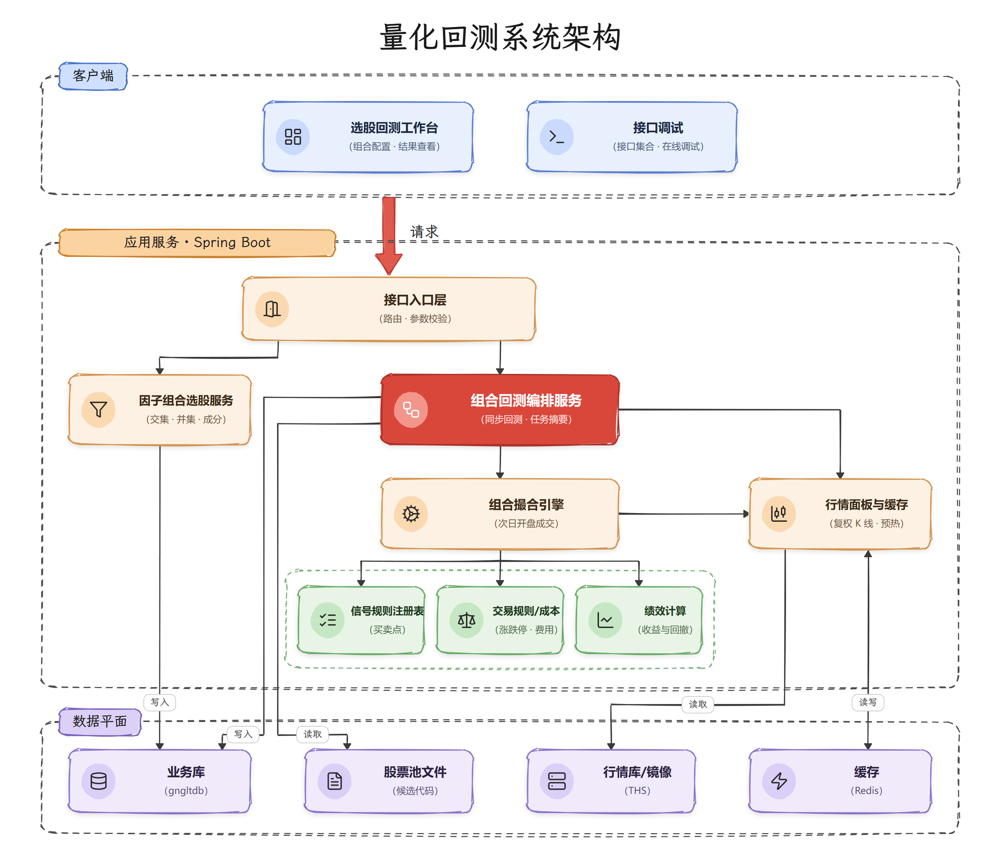
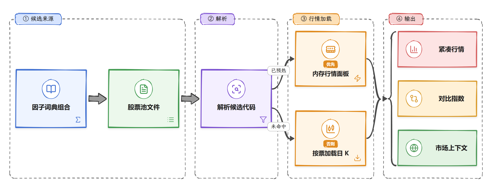
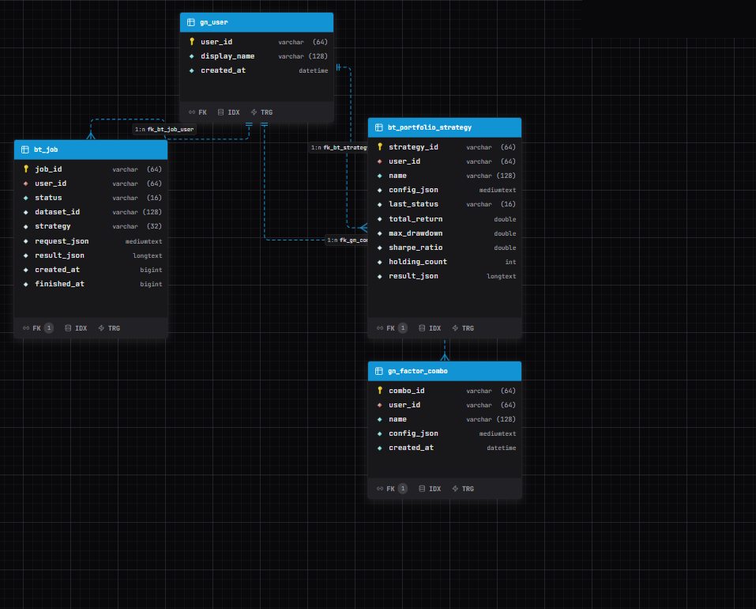
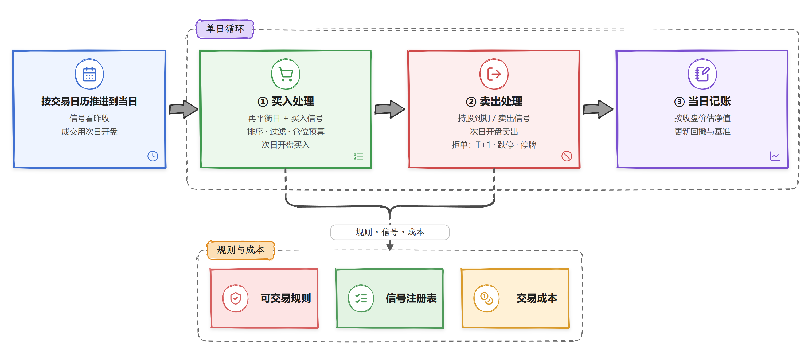
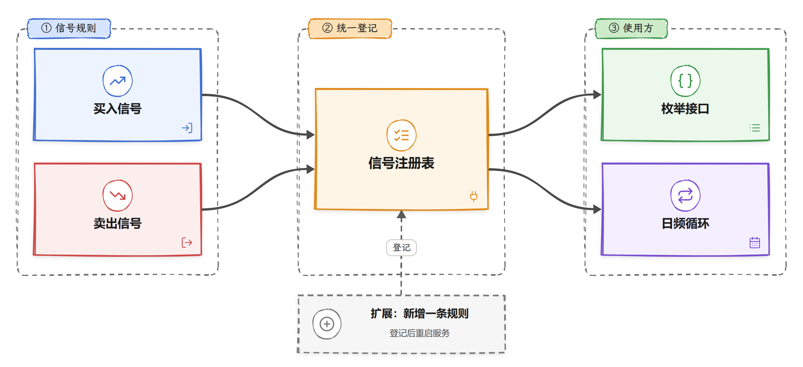

import { BacktestFlow } from "/snippets/portfolio-flow.jsx";

## 1. 目标与范围

### 1.1 目标

提供**可复现的 A 股日频组合回测**能力：

1. 候选池（股票池文件 / 因子词典组合）+ 交易模型配置 → 模拟撮合与绩效；
2. 任务摘要落 `bt_job`。净值、成交、期末持仓只在进程内存；
3. 行情可走同花顺远端或本地镜像，支撑全 A 级加载与预热。

### 1.2 范围内 / 范围外

| 范围内（当前） | 范围外（暂不做或未做） |
|----------------|------------------------|
| 日频事件驱动组合回测 | Level-2 / 盘口撮合 |
| 昨收信号 → 次日开盘成交 | 分钟线、逐笔回放 |
| 因子词典交并集选股 | 策略榜单、关注和个人中心 |
| 涨跌停/停牌/T+1/成本 | 机构级绩效库（empyrical 等）对接 |
| 买卖信号规则注册表横扩 | 再平衡/仓位模式的插件化注册 |

---

## 2. 总体架构

<Frame>
  
</Frame>

---

## 3. 模块划分

| 模块 | 职责 |
|------|------|
| 组合回测 | API、配置、引擎编排 |
| 买卖信号 | 信号规则与登记 |
| 交易规则 | 成本、涨跌停、停牌、市场上下文 |
| 绩效 | Sharpe、换手近似 |
| 行情面板 / 缓存 | 紧凑行情、全市场预热、缓存 |
| 因子组合 | 交并集预览、保存、板块成分刷新 |

---

## 4. 数据平面

### 4.1 库职责

| 角色 | 库 | 用途 |
|------|----|------|
| 行情读 | `lm_ths_db` 或 `gngltdb` 镜像（`quant.ths.mode`） | 日 K、复权、证券、涨跌停/ST/停牌/股本/日历/行业 |
| 业务写 | `gngltdb` | `bt_job` 摘要、`bt_portfolio_strategy`、`gn_*`。成交不写库 |
| 缓存 | Redis + Caffeine | 日 K 序列缓存；Panel 内存面板 |

### 4.2 加载路径

<Frame caption="候选池解析与行情加载路径">
  
</Frame>

镜像同步与表说明见 [行情镜像（THS → gngltdb）](/data/mirror)、[同花顺库表结构：lm_ths_db](/data/ths/index)、[测试库 gngltdb](/data/gngltdb/index)。

### 4.3 表结构关系

<Frame caption="业务库表关系。成交留在进程内存。">
  
</Frame>

核心关系：`gn_user` 一对多拥有回测任务、已保存策略和因子组合。

---

## 5. 回测主链路

### 5.1 产品路径

点击节点，或用上一步 / 下一步，沿同步回测路径查看每一步。可以拖动画布。

<BacktestFlow />

### 5.2 撮合引擎

<Frame caption="撮合引擎单日循环与成本/规则">
  
</Frame>

**不是盘口撮合**，为日频简化事件驱动：

| 项 | 口径 |
|----|------|
| 信号确认 | 昨收 bar |
| 成交价 | 次日开盘，扣除佣金和滑点；卖出再扣印花税 |
| 日历 | 有镜像交易日历时与基准取交集，否则用基准交易日 |
| T+1 | 默认开启：当日买入不可卖 |
| 可交易性 | 停牌不成交；开盘达到当日涨停价不可买、达到跌停价不可卖。优先用镜像涨跌停价。 |
| 仓位 | `positionRatio` / `maxStockWeight` / `maxHoldings` / `maxDailyBuys`；按手取整 |
| 再平衡 | `DAILY` / `WEEKLY` / `MONTHLY`（仅约束买入日） |
| 过滤 | 排除 ST 默认关闭；动量前 N%、流通市值下限、同申万一级行业持仓上限可选。 |

### 5.3 信号规则横扩

<Frame caption="买卖信号注册表扩展设计">
  
</Frame>

- 内置买入：`SMA_GOLDEN` / `UNIVERSE_RANK`。卖出：`MA_DEATH` / `MA_TOP_DIV` / `HOLD_PERIOD`，以及 RSI、BOLL、KDJ、MACD、阴线、均线条件。默认卖出仍是 `MA_DEATH`。
- 回测开始时把选中的规则绑好，热路径不再按名字查找
- 枚举选项：`GET /portfolio/meta` 的 `buySignal` / `sellSignal` **来自已登记的规则**
- **扩展**：新增一条规则并登记后重启

再平衡 / 仓位模式等仍为引擎内字符串分支，后续可按同样模式插件化。

### 5.4 因子词典组合选股

| 能力 | 说明 |
|------|------|
| 组合 | 最多 10 因子；AND（交集）/ OR（并集） |
| 条件 | HIT / LT / GT / BETWEEN / PERCENTILE（相对 `gn_factor_signal`） |

---

## 6. 绩效指标

| 指标 | 口径摘要 |
|------|----------|
| 总收益 / 基准收益 | 期末权益 / 初始 − 1；基准按指数等比缩放 |
| 最大回撤 | 净值 peak 回撤 |
| 年化 | `(1+R)^(252/N)−1` |
| Sharpe | 日收益均值/标准差 × √252（rf=0；总体方差） |
| 换手 | 双边成交额 / (初始资金 × 交易日)，**近似密度** |
| 成交/拒单 | 撮合计数 |

---

## 7. 持久化数据存储

| 表 / 存储 | 内容 |
|-----------|------|
| `bt_job.result_json` | 收益、耗时、拒单次数。字段见 [查询组合回测任务](/api-reference/portfolio-backtest/job) |
| 进程 `reportCache` | 净值曲线、逐笔成交、期末持仓。 |
| `bt_portfolio_strategy` | 用户保存的交易配置 |
| `gn_factor` / `gn_factor_signal` / `gn_factor_combo` | 因子与组合 |
