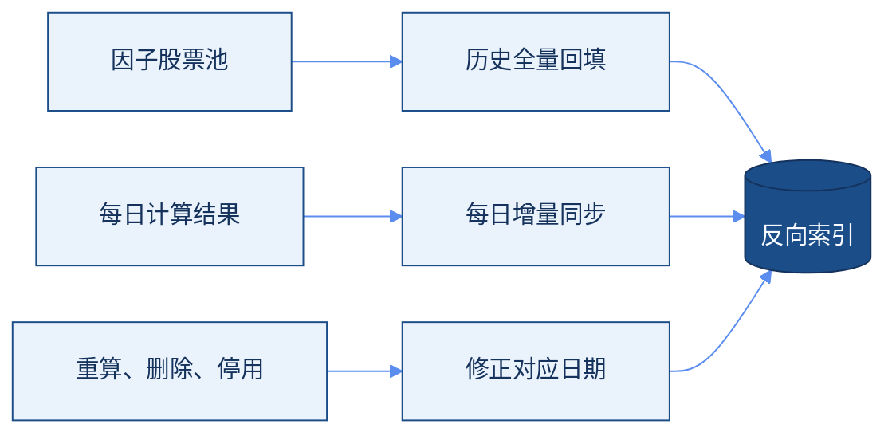

用户给出一只或多只股票，并为每只股票设置查询区间和匹配度阈值。系统找出在对应区间里选中过这些股票的因子，展示匹配因子、命中次数、命中日期和匹配度。

<Columns cols={2}>
  <Card title="现在已有" icon="arrow-right">
    因子指向股票池。按因子和交易日，查出当天入选的股票。
  </Card>
  <Card title="这次补上" icon="arrow-left">
    股票指向因子。按股票和日期区间，反查曾经选中它的因子。
  </Card>
</Columns>

## 现有基础

| 能力 | 现状 |
| --- | --- |
| 因子库和因子元数据 | 已有，不用重建 |
| 因子股票池 | 可以按因子和交易日查出股票池 |
| 因子信号记录 | 每个交易日、同一个因子、同一只股票最多一条 |
| 待补能力 | 用股票代码和日期反查因子，避免逐个因子去扫 |

## 反向索引

在现有正向股票池之外，加一层因子股票信号反向索引。历史数据先全量回填，之后每天只同步增量。



<Card title="第一阶段用 MySQL" icon="database">
  唯一约束是股票代码、信号日期、因子 ID，避免同一条信号写两次。查询按股票代码和信号日期走，用来按股票和时间范围检索。
</Card>

- 用现有历史因子股票池做一次全量回填。
- 每日因子计算完成后做增量同步。
- 因子重算、删除或停用时，要改掉对应日期的索引。只追加、不清理，查询结果会偏。

## 匹配规则

<Steps>
  <Step title="单只股票">
    因子在这只股票的区间里至少有一次有效信号，并且达到这只股票自己的匹配度阈值。
  </Step>
  <Step title="多只股票">
    用 AND。同一个因子必须分别满足每一只股票的区间和阈值，才进入最终结果。
  </Step>
  <Step title="不要求同一天">
    几只股票可以在不同交易日被同一个因子选中。
  </Step>
  <Step title="带回命中日期">
    结果里给出该因子在各股票区间内的实际命中日期。
  </Step>
</Steps>

```text
匹配度 = 区间内该因子命中该股票的信号次数
       ÷ 区间内该因子的有效信号总次数
       × 100%
```

<Warning>
  反向索引能给出命中次数，也就是分子。不能把索引里的记录条数直接当成分母。分母来自因子有效信号的统计，并且要先统一什么叫有效信号。
</Warning>

## 一次查询


## 实施顺序

| 阶段 | 做什么 |
| --- | --- |
| 第一阶段 | 建 MySQL 反向索引，完成历史全量回填 |
| 第二阶段 | 接入每日增量同步，以及重算后的修正 |
| 第三阶段 | 做因子拆解查询：多股票交集、匹配度、命中日期 |
| 第四阶段 | 做一致性校验、查询监控和性能优化 |

<Note>
  要分清三种情况：因子正常运行但没选中这只股票，因子没运行或运行失败，以及正常运行但当天股票池是空的。缺数据不能当成未命中。
</Note>

## 以后可以复用

这层索引可以继续给自然语言选股、股票因子画像、因子关联分析和研究助手用。一开始不必上额外组件。等到 MySQL 的查询压力或历史数据量成为瓶颈，再考虑热点缓存，或单独的分析存储。

## 结论

保留现有因子库、因子计算和正向股票池。新增因子股票信号反向索引，用历史全量初始化、每日增量同步，以及查询时的多股票交集，支持因子拆解。
