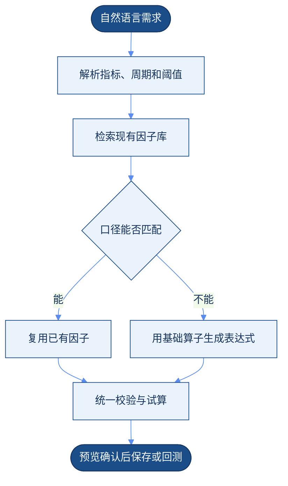
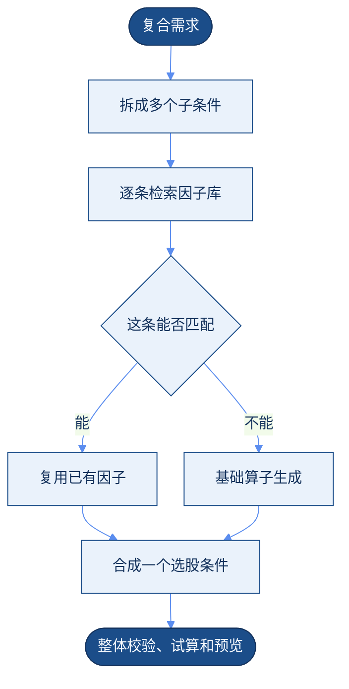

用户用自然语言写出选股思路或投资偏好。系统先在现有因子库里找能直接用的因子；覆盖不了的部分，再用基础算子拼成个人因子。预览和试算确认之后，可以保存，也可以拿去选股或回测。

<Columns cols={2}>
  <Card title="已有因子匹配" icon="search">
    指标、含义和周期与因子库足够接近时，直接复用，不另写一套计算。
  </Card>
  <Card title="个人偏好计算" icon="sigma">
    因子库覆盖不了时，只用已注册的基础算子，组合成结构化表达式。
  </Card>
</Columns>

## 总流程

## 已有因子怎么匹配

适合指标含义、计算周期和现有因子一致或足够接近的描述。

<Steps>
  <Step title="抽出意图">
    识别指标含义、计算周期、方向、阈值和适用范围。
  </Step>
  <Step title="检索因子库">
    按因子名称、描述、标签、元数据和计算口径找候选。
  </Step>
  <Step title="核对口径">
    比较语义是否接近，并核对周期、复权、公式和数据频率。
  </Step>
  <Step title="达到标准再复用">
    返回已有因子及其定义。需要时先让用户确认。
  </Step>
  <Step title="额外条件不改定义">
    用户另外指定的阈值、排序或组合，只作为筛选条件，不改原因子本身。
  </Step>
</Steps>

> 找出近 20 日动量较强的股票。

系统识别「动量」和「20 日」。因子库里有口径相符的动量因子时，直接复用，再套上用户说的强弱条件。

<Warning>
  语义相近不等于计算口径相同。周期、复权方式、计算公式或数据频率不一致时，要提示差异，不能当成完全匹配。
</Warning>

## 个人偏好怎么生成

适合个性化指标、特殊组合，以及因子库里没有合适因子的情况。

算子从已注册的集合里选，例如加减乘除、比较、排名、滚动均值、涨跌幅、逻辑与和逻辑或。表达式要检查字段、参数、周期、算子类型和数据依赖。试算时看空值、异常值、结果分布和耗时。页面上给出因子含义、计算逻辑和样例，用户确认后才保存为个人因子。

> 找出最近 5 日平均成交额高于过去 20 日平均成交额 1.5 倍，且近 10 日涨幅为正的股票。

| 片段 | 怎么处理 |
| --- | --- |
| 近 5 日平均成交额 | 滚动均值 |
| 近 20 日平均成交额 | 滚动均值 |
| 前者高于后者 1.5 倍 | 比较 |
| 近 10 日涨幅为正 | 涨跌幅，再与 0 比较 |
| 两个条件同时成立 | 逻辑与 |

<Warning>
  生成时只能选用系统已注册、已授权的基础算子。不直接生成并执行任意代码或 SQL。个人因子保存成结构化表达式，不只留下自然语言，也不留下难以维护的代码。
</Warning>

## 混合需求

一句话里可以同时有现有因子和个人条件。系统按子条件拆开，能复用的复用，不能复用的再生成，最后合成一个选股条件。

> 找出近 20 日动量排名靠前，同时近 5 日平均成交额比近 20 日平均成交额高 50% 的股票。

「近 20 日动量排名靠前」优先匹配现有动量因子。「成交额均值比值高于 1.5」用基础算子生成。

## 模块

| 模块 | 做什么 |
| --- | --- |
| 自然语言解析 | 识别意图，拆出指标、周期、阈值和逻辑关系 |
| 因子检索匹配 | 按名称、描述、标签和元数据找已有因子 |
| 基础算子管理 | 提供可用算子、参数约束、数据类型和计算说明 |
| 因子表达式生成 | 把未匹配的需求写成标准表达式 |
| 因子校验与试算 | 检查表达式、数据依赖和异常值，并用历史数据试算 |
| 因子组合 | 把已有因子和个人偏好条件合在一起 |
| 个人因子管理 | 保存、查看、修改、复用和删除用户自己的因子 |

## 设计要求

| 要求 | 做法 |
| --- | --- |
| 优先复用 | 能匹配已有因子时，不重复生成同类计算 |
| 匹配可解释 | 展示匹配到的因子、口径、周期和理由；有差异就写明 |
| 算子白名单 | 只允许已注册算子，不执行任意代码或 SQL |
| 表达式标准化 | 保存结构化表达式，方便以后修改 |
| 执行前校验 | 检查参数、字段权限、数据是否可用、周期和资源消耗 |
| 结果可追溯 | 留下表达式版本、参数、数据口径和创建来源 |
| 用户确认 | 正式保存或用于回测之前，先展示定义和试算结果 |

## 实施顺序

| 阶段 | 做什么 |
| --- | --- |
| 第一阶段 | 整理因子元数据和基础算子目录，统一描述方式 |
| 第二阶段 | 做自然语言解析、已有因子检索和匹配结果展示 |
| 第三阶段 | 做算子组合、表达式生成、校验和试算 |
| 第四阶段 | 支持已有因子和个人偏好条件混在一起 |
| 第五阶段 | 完善个人因子的保存、版本、回测接入和使用反馈 |

## 结论

整体顺序是：解析自然语言，优先匹配因子库，未匹配的部分用基础算子生成，统一校验试算，再由用户确认。已有因子靠复用减少重复计算；个人因子靠标准算子和结构化表达式保持灵活。两类因子最后都进入同一套执行和选股流程。
